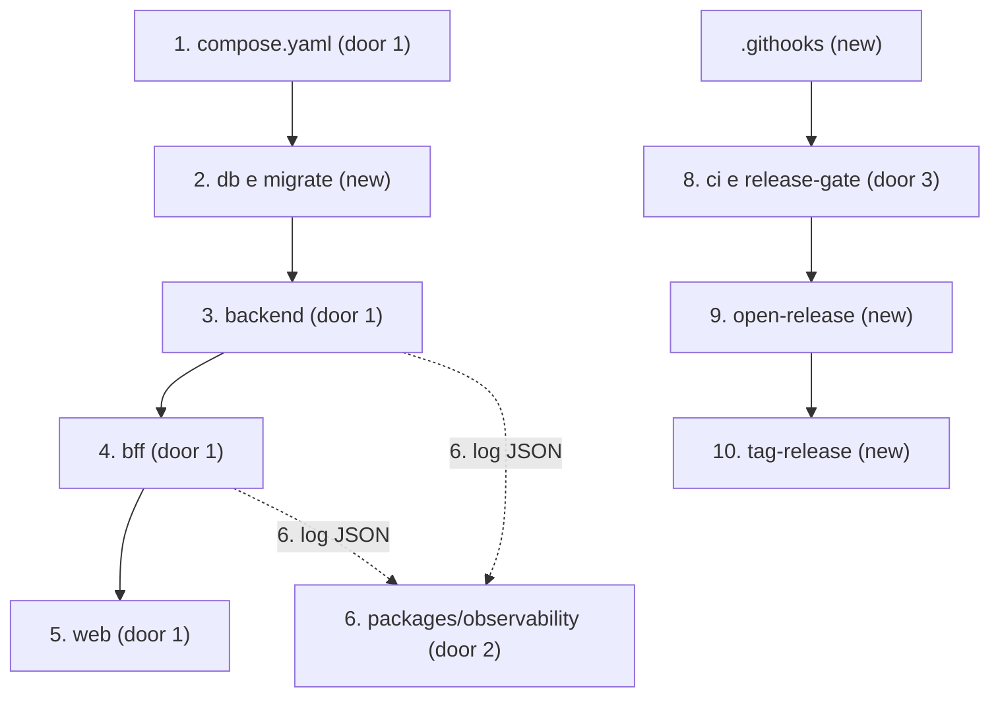

# F0 - Fundação

**Approved**: 2026-11-02 - user: "pronto"

## Problem

Quem vai implementar qualquer regra do Quadralug hoje não tem onde colocá-la, como executá-la nem como prová-la. O repositório só tem documentos, e `develop` e `main` estão vazias de código. Quem paga é o autor: sem camadas verificadas, cada fase decide padrão por conta própria; sem logs correlacionados, uma falha entre BFF e backend não pode ser seguida; sem CI, a regra de branch depende de memória. A evidência é a §2 do TDD ("Não há base arquitetural") e o estado atual do repositório.

Quando isto for entregue, um clone novo sobe os cinco serviços saudáveis com um comando, uma requisição pode ser seguida de ponta a ponta nos logs, uma violação de camada quebra o gate, e nenhum código chega a `main` sem passar por PR e CI.

## Shape

Reusa o `make` como única porta de entrada: quem desenvolve e o GitHub Actions rodam os mesmos alvos. As regras que mudam um resultado rodam onde `pytest` e o shell alcançam: `packages/observability` (formato e redação de logs), `tools/git_policy.py` (origem de PR, versão, tag), `tools/mutation_gate.py` (meta de mutação) e `.githooks/`. Não há regra de negócio nesta fase.

1. `make up` -> `compose.yaml` (door 1) - constrói as imagens com tag do commit e sobe `db`
2. `db` (new) - fica `healthy` e libera `migrate` (new), que aplica `alembic upgrade head` sem revisões e termina com 0
3. `migrate` -> `backend` (door 1) - sobe só depois de `migrate` terminar, e `/health/ready` checa o banco
4. `backend` -> `bff` (door 1) - sobe com o backend `healthy`, e `/health/ready` checa o backend com `traceparent`
5. `bff` -> `web` (door 1) - sobe por último e serve a página React na porta 8080
6. Cada requisição em `bff` e `backend` -> `packages/observability` (door 2) - uma linha JSON no stdout, com `trace_id` e atributos sensíveis redigidos
7. Commit e push locais -> `.githooks/` (new) - recusam o que está fora de `feature/*`
8. PR no GitHub -> `ci.yml` ou `release-gate.yml` (door 3) - rodam `tools/git_policy.py` e os alvos de `make`, e o ruleset só libera o merge com o job verde
9. `open-release.yml` (new) - valida a versão, cria `release/x.y.z` e abre o PR para `main`
10. out: merge em `main` -> `tag-release.yml` (new) - cria a tag `vX.Y.Z` e, se a release recebeu correção, abre o PR de `main` para `develop`

**Changes underneath**

| Front       | What changes                                                                                                                                       |
| ----------- | -------------------------------------------------------------------------------------------------------------------------------------------------- |
| domain      | nada: pacotes de domínio nascem vazios, só para os contratos de camada terem o que verificar                                                     |
| stored data | nada a migrar: `migrate` não tem revisões, e o único efeito possível é a tabela `alembic_version`                                         |
| readers     | `plan.md` da raiz: o gatilho do `tag-release.yml` vira "PR para `main` fechado com merge", porque só esse evento informa a branch de origem |
| GitHub      | os rulesets `develop-main` e `release` ganham `ci` e `release-gate` como checks obrigatórios durante o PR desta fase                      |

Data: none - as tabelas de identidade nascem na F2.

## Surface

| Route                               | In                       | Out                                                             | Status           | Who                                          |
| ----------------------------------- | ------------------------ | --------------------------------------------------------------- | ---------------- | -------------------------------------------- |
| `GET /health/live` (backend, bff) | -                        | `{"status":"ok"}`                                             | `200`          | anyone - alcançável só pelas redes Docker |
| `GET /health/ready` (backend)     | -                        | `{"status":"ok"}`, ou Problem Details com `code: not_ready` | `200`, `503` | anyone - alcançável só pelas redes Docker |
| `GET /health/ready` (bff)         | `traceparent` opcional | `{"status":"ok"}`, ou Problem Details com `code: not_ready` | `200`, `503` | anyone - alcançável só pelas redes Docker |
| `GET /` (web)                     | -                        | página HTML                                                    | `200`          | anyone                                       |

Comandos: `make setup`, `up`, `down`, `check`, `integration`, `mutation` e `e2e` mostram a saída da ferramenta e saem com 0, ou com outro código em caso de falha. O workflow `open-release` é acionado manualmente com a entrada `version` por quem tem escrita no repositório.

## Landing

| One-way door                | Literal shape                                                                                                                                                                                                                                              | Alternative rejected                                                                                                  |
| --------------------------- | ---------------------------------------------------------------------------------------------------------------------------------------------------------------------------------------------------------------------------------------------------------- | --------------------------------------------------------------------------------------------------------------------- |
| 1. Layout e workspace       | `services/backend`, `services/bff`, `packages/observability`, `web`, `tools`; `uv.lock` único na raiz; Dockerfile com contexto na raiz. Backend em `src/quadralug_backend/{identity,weather}/{domain,application,infrastructure,interface}` | Um projeto Python por serviço com lockfiles próprios: o pacote de observabilidade teria de ser publicado ou copiado |
| 2. Contrato de log          | Uma linha JSON com `timestamp`, `severity_text`, `severity_number`, `body`, `trace_id`, `span_id`, `resource`, `attributes`, como na §7 do TDD                                                                                            | Formato de console do SDK: multilinha e sem contrato estável para um coletor futuro                                  |
| 3. Nomes dos checks         | Jobs `ci` e `release-gate`, referenciados pelos rulesets (AD-009)                                                                                                                                                                                      | Exigir cada ferramenta como check separado: cada mudança de ferramenta exigiria mudar o ruleset                      |
| 4. Stack de observabilidade | `opentelemetry-sdk`, instrumentações de FastAPI, httpx e SQLAlchemy, e `opentelemetry-exporter-otlp-proto-http`                                                                                                                                      | `structlog` sobre `logging`: não segue o OTel Logs Data Model nem correlaciona trace sozinho                     |
| 5. Fluxo de release         | AD-001 a AD-004                                                                                                                                                                                                                                            | Ver as alternativas na decisão do autor registrada em `.specs/STATE.md`                                            |
| 6. Concorrência do BFF      | Rotas `async def` com `httpx.AsyncClient` e `asyncio.timeout` para o prazo total (AD-013). Achada pelo Verifier durante o build                                                                                                                         | Rotas síncronas com `httpx.Client`: o timeout vale por operação, e uma resposta em partes ultrapassava 5 s          |

- Nothing else in this change is hard to reverse

## Criteria

### S1: O ambiente sobe do zero (P1)

Um comando leva um clone a cinco serviços no estado esperado, com o isolamento do TDD.

**Acceptance Criteria**

1. WHEN o autor roda `make up` em um clone após `make setup` THEN o sistema SHALL sair com 0, com `db`, `backend`, `bff` e `web` em `healthy` e `migrate` em `exited (0)`
2. IF `migrate` terminar com código diferente de 0 THEN `backend`, `bff` e `web` SHALL não iniciar, e `make up` SHALL sair com código diferente de 0
   - banco acessível → sobe; senha errada no `migrate` → para antes do backend
3. The Compose SHALL publicar no host apenas a porta 8080, no serviço `web`
   - `bff`, `backend`, `db` e `migrate` sem `ports`
4. The Compose SHALL ligar `web` a `public`, `bff` a `public` e `internal`, `backend` a `internal` e `data`, `db` e `migrate` só a `data`, com `data` em `internal: true` e `internal` sem essa opção
5. The Compose SHALL entregar credenciais do MySQL apenas a `db`, `backend` e `migrate`
   - nenhuma variável com `MYSQL` ou `DATABASE` em `bff` e `web`
6. WHEN `GET /health/live` chega ao `backend` ou ao `bff` THEN o serviço SHALL responder `200` e `{"status":"ok"}` sem consultar dependências
   - banco fora do ar → `backend` ainda responde `200` em `/health/live`
7. WHEN `GET /health/ready` chega ao `backend` THEN ele SHALL responder `200` com o banco acessível e `503` com `application/problem+json` e `code: not_ready` com o banco inacessível
8. WHEN `GET /health/ready` chega ao `bff` THEN ele SHALL responder `200` com o `/health/ready` do backend em `200`, e `503` com `code: not_ready` com o backend em erro, inacessível ou sem resposta em 5 s
9. WHEN `GET /` chega à porta 8080 THEN o `web` SHALL responder `200` com a SPA React, cujo teste de componente encontra o título `Quadralug`
10. The imagens de `backend` e `bff` SHALL rodar com UID diferente de 0 e instalar dependências com `uv sync --frozen`
11. WHEN `make up` constrói as imagens THEN elas SHALL receber a tag do commit curto via `IMAGE_TAG`
12. WHEN o autor roda `make down` THEN os containers SHALL ser removidos, e o volume do MySQL SHALL permanecer

### S2: Uma requisição pode ser seguida (P1)

Os logs têm qualidade de produção desde o primeiro dia.

**Acceptance Criteria**

13. WHEN uma requisição chega ao `/health/ready` do `bff` THEN os logs de `bff` e `backend` dessa requisição SHALL ter o mesmo `trace_id` de 32 caracteres hexadecimais
    - com `traceparent` recebido → o `trace_id` é o recebido; sem `traceparent` → um novo `trace_id`, igual nos dois serviços
14. The serviços SHALL emitir cada log como uma linha JSON no stdout, com as chaves `timestamp`, `severity_text`, `severity_number`, `body`, `trace_id`, `span_id`, `resource` e `attributes`, e `timestamp` em UTC terminado em `Z`
    - `WARNING` → `severity_number` 13; log fora de span → `trace_id` e `span_id` nulos; mensagem com quebra de linha → ainda uma única linha
15. The `resource` de cada log SHALL ter `service.name` igual a `quadralug-bff` ou `quadralug-backend` e `deployment.environment` vindo de `DEPLOYMENT_ENVIRONMENT`
16. WHEN uma requisição HTTP termina THEN o serviço SHALL registrar um log INFO com `http.request.method`, `http.route`, `http.response.status_code` e `duration_ms`
17. IF o último segmento da chave de um atributo for `password`, `password_hash`, `token`, `cookie`, `set-cookie`, `authorization` ou `email`, sem diferenciar maiúsculas THEN o log SHALL trazer `[REDACTED]` no valor
    - `Email` → redigido; `http.request.header.cookie` → redigido; `enduser.id` → preservado
18. WHERE `OTEL_EXPORTER_OTLP_ENDPOINT` estiver definido the serviços SHALL exportar por OTLP, e IF não estiver definido THEN nenhum exportador OTLP SHALL ser criado

### S3: O gate local recusa código fora do padrão (P1)

`make check` é a prova de que uma mudança respeita os padrões, antes de qualquer push.

**Acceptance Criteria**

19. WHEN o autor roda `make check` THEN o sistema SHALL executar ruff, mypy, import-linter, testes unitários Python e Vitest, e sair com 0 só se todos passarem
    - violação plantada de ruff → diferente de 0; teste Vitest falhando → diferente de 0
20. IF um módulo em `domain` ou `application` tiver função sem anotação de tipo THEN `make check` SHALL sair com código diferente de 0
21. IF um import violar a regra de dependência THEN `lint-imports` SHALL sair com código diferente de 0 e citar o contrato violado
    - `identity.domain` importa `fastapi`, `sqlalchemy` ou `pydantic` → falha; `identity.application` importa `identity.infrastructure` → falha; `identity` importa `weather` → falha; `quadralug_bff.application` importa `quadralug_bff.interface` → falha
22. WHEN `make mutation` termina THEN `tools/mutation_gate.py` SHALL sair com 0 somente se mutantes mortos dividido pelo total for no mínimo 80%
    - 80 de 100 → 0; 79 de 100 → diferente de 0; 0 mutantes → diferente de 0

### S4: As regras de branch valem antes do GitHub (P1)

Os hooks param o erro na máquina, e o GitHub é a garantia final.

**Acceptance Criteria**

23. IF o autor tentar um commit com `HEAD` fora de `feature/*` THEN `.githooks/pre-commit` SHALL recusar com código diferente de 0 e citar a branch atual
    - `feature/x` → aceito; `main`, `develop`, `release/0.1.0`, `featurex` e `HEAD` destacado → recusados
24. IF um push tiver como destino uma ref fora de `refs/heads/feature/*` THEN `.githooks/pre-push` SHALL recusar com código diferente de 0
    - `feature/x` → aceito; `feature/x:develop` → recusado; uma tag → recusada
25. WHEN o autor roda `make setup` THEN o sistema SHALL apontar `core.hooksPath` para `.githooks` e criar `.env` a partir de `.env.example`, sem sobrescrever um `.env` existente
26. IF um push ignorar os hooks e mirar `develop` ou `main` THEN o GitHub SHALL recusá-lo
    - push real com `--no-verify` de um clone temporário, com a recusa citando a regra do repositório

### S5: O GitHub Actions orquestra a promoção (P1)

Código só avança por PR, com CI verde e merge do autor.

**Acceptance Criteria**

27. WHEN `tools/git_policy.py` recebe origem e destino de um PR THEN ele SHALL sair com 0 somente para `feature/*` → `develop`, `main` → `develop`, `feature/*` → `release/*` e `release/*` → `main`
    - `develop` → `main`, `feature/x` → `main` e `release/0.1.0` → `develop` → recusados; PR de fork para `main` → recusado
28. WHEN um PR mira `develop` ou `release/**` THEN o workflow `ci` SHALL rodar o job de mesmo nome, com `tools/git_policy.py`, `make check` e `make integration`
29. WHEN um PR mira `main` THEN o workflow `release-gate` SHALL rodar o job de mesmo nome, com `tools/git_policy.py`, `make check` e `make integration`
30. IF o workflow `open-release` receber uma versão fora de `^\d+\.\d+\.\d+$`, ou uma versão cuja branch ou tag já exista THEN ele SHALL falhar sem criar nada
    - `0.1.0` → aceita; `v0.1.0`, `0.1` e `0.1.0-rc1` → recusadas
31. WHEN uma versão válida é informada THEN o workflow `open-release` SHALL criar `release/x.y.z` a partir de `develop` e abrir o PR para `main`
32. WHEN um PR de `release/x.y.z` do próprio repositório é mesclado em `main` THEN o workflow `tag-release` SHALL criar `vX.Y.Z` no commit de merge
    - PR fechado sem merge → nada; origem fora de `release/*` → nada
33. IF a branch `release/x.y.z` mesclada tiver commits ausentes de `develop` THEN o workflow `tag-release` SHALL abrir o PR de `main` para `develop`, e IF não tiver THEN nenhum PR SHALL ser aberto
34. The workflows SHALL declarar `permissions` mínimas, fixar cada action em um SHA completo, não interpolar `${{ github.* }}` nem `${{ inputs.* }}` dentro de `run`, e passar no `actionlint`
35. The secret `PROMOTION_TOKEN` SHALL aparecer apenas nos workflows `open-release` e `tag-release`
36. The `AGENTS.md` SHALL declarar `mutations: 3`, o nível de teste por camada, as regras de branch, a autorização de push pelo OK da Parada 2 e a exigência do trailer `Co-Authored-By`, e o `CLAUDE.md` SHALL apontar para ele

## Out of scope

| Excluded                                                 | Why                                                                                                                     |
| -------------------------------------------------------- | ----------------------------------------------------------------------------------------------------------------------- |
| Proxy `/api`, CSP, rate limit e cabeçalhos no nginx   | Tarefa da F5 no `plan.md` da raiz                                                                                     |
| Revisões Alembic e tabelas                              | F2                                                                                                                      |
| Rotas públicas e de domínio                            | F2 a F4; aqui só existem health checks                                                                                 |
| Meta de cobertura ≥ 90% no gate                         | `pytest-cov` entra agora, e a meta passa a valer na F1, quando há `domain` e `application`                       |
| `make mutation` e `make e2e` no `release-gate.yml` | Entram na F1 e na F5, junto com as suítes que executam. Até lá, `make e2e` falha dizendo que ainda não há suíte |
| Filtro de saída da rede por destino                     | O Compose não oferece (AD-006)                                                                                         |
| Validação do `traceparent` pelo nginx                | O nginx só encaminha cabeçalhos a partir da F5                                                                        |

## Assumptions

| Assumption                              | Chosen default                                                                                                                                                                                                       | Rationale                                                                                    | Confirmed? |
| --------------------------------------- | -------------------------------------------------------------------------------------------------------------------------------------------------------------------------------------------------------------------- | -------------------------------------------------------------------------------------------- | ---------- |
| Fluxo de branches e papéis             | AD-001 a AD-004                                                                                                                                                                                                      | Respostas do autor em 2026-10-31                                                             | y          |
| Prova dos workflows                     | Os critérios 27 a 35 têm prova estática e por script no `HEAD`. A execução real acontece nas etapas 11 a 13 do `plan.md` da raiz, porque depende de PR aberto                                               | O Verifier roda antes do push, e nenhum PR real existe nesse momento                         | y          |
| Prova de que CI vermelha bloqueia merge | Na etapa 11, depois de incluir o check `ci` no ruleset, Claude abre um PR temporário `feature/ci-red-probe` com teste quebrado, confirma que o merge é recusado e fecha o PR. O OK da Parada 2 cobre esse push | É a única forma de provar o bloqueio de ponta a ponta                                      | y          |
| Gatilho do `tag-release.yml`          | `pull_request` `closed` em `main`, em vez de push                                                                                                                                                              | Só esse evento informa a branch de origem e o SHA dela, necessários aos critérios 32 e 33 | y          |
| Identidade dos commits                  | `user.email` local com o *noreply* do GitHub (AD-005)                                                                                                                                                            | O autor removeu o e-mail do TDD antes da publicação                                        | y          |
| Rotas de hello-world                    | Nenhuma: o trace é provado no `/health/ready` do BFF, que já chama o backend                                                                                                                                     | Evita código temporário                                                                    | y          |
| `migrate` nesta fase                  | Alembic configurado, sem revisões                                                                                                                                                                                   | Prova conexão, ordem de subida e código de saída, e a F2 só adiciona revisões           | y          |
| Redação de logs                       | Mecanismo no formatter, além da disciplina dos chamadores                                                                                                                                                           | "Nunca registrar" precisa de um mecanismo que o garanta                                      | y          |
| Actions fixadas por SHA                 | Toda action referenciada por SHA completo                                                                                                                                                                            | Repositório público com um token de escrita em secret                                      | y          |

**Open questions:** none

## Differences from the source

None - the product matches the source

## Sources

- `plan.md` (raiz) - binding - fluxo das fases, entregas e provas da Fase 0, ajustes ao TDD
- `.tdd/quadralug-conta-e-home.md` - binding - arquitetura (§4.1, §4.3, §4.7), observabilidade (§7), ferramentas de teste (§6)
- `.prd/quadralug-conta-e-home.md` - binding - nenhum critério da Journey fecha nesta fase; ele limita o escopo
- Conversa com o autor em 2026-10-31 - binding - fluxo de branches, cadência de release, papel do Actions, repositório público, autoria de push e merge
