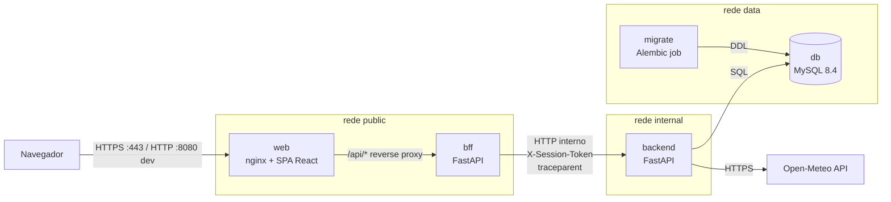
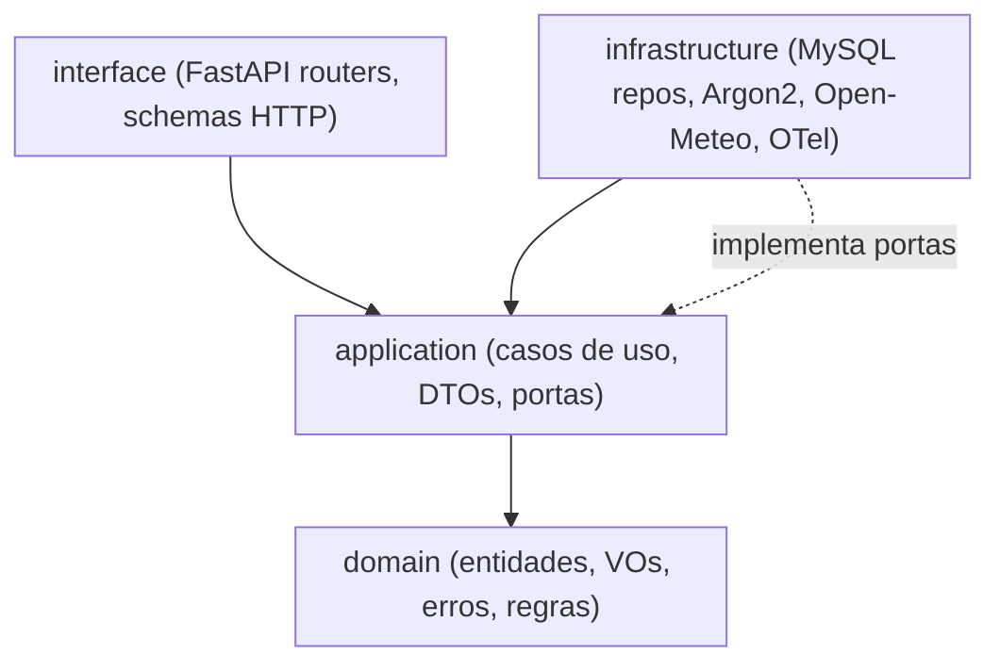
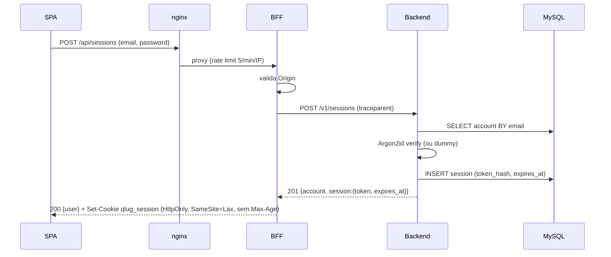
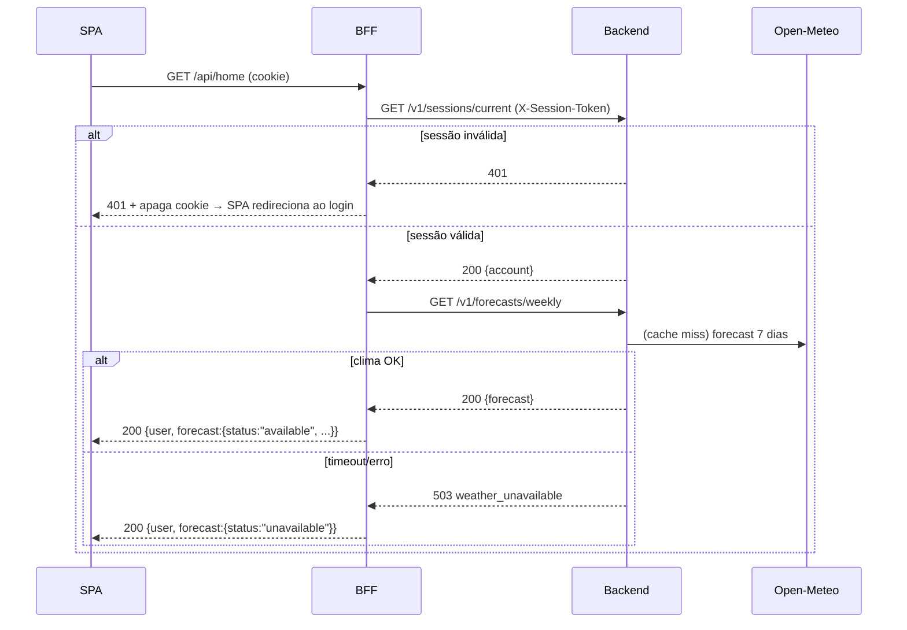

# TDD - Quadralug: Conta e Home

| Campo            | Valor                                                              |
| ---------------- | ------------------------------------------------------------------ |
| PRD              | [.prd/quadralug-conta-e-home.md](../.prd/quadralug-conta-e-home.md) |
| Status           | Draft                                                              |
| Tamanho          | Médio (2–4 semanas, ritmo de estudo)                             |
| Criado           | 2026-10-28                                                         |
| Última revisão | 2026-10-28                                                         |

---

## 1. Contexto

O Quadralug é uma plataforma de aluguel de 4 quadras em Salvador, BA: 2 cobertas (ginásio) e 2 a céu aberto. Esta é a primeira fase do produto. Ela entrega criação de conta, login, logout e uma home com a previsão do tempo de Salvador para hoje e os próximos 6 dias. O comportamento esperado está fechado no PRD, cuja tabela de *Journey* é o critério de aceite. Este documento não reabre essas decisões.

O projeto também é um veículo de aprendizado. Por isso adota práticas explícitas desde o início: DDD, Clean Architecture, SOLID, DRY, KISS e YAGNI no código; AAA e FIRST nos testes unitários, com *mutation testing* (mutmut) e *property-based testing* (Hypothesis); e logs estruturados no padrão OpenTelemetry. Tudo roda em containers Docker.

**Domínio**: reservas esportivas. Esta fase cobre só o subdomínio de **Identidade** (contas e sessões) e o subdomínio genérico de **Clima** (previsão). A reserva, que é o domínio central, vem na próxima fase e vai depender das contas criadas aqui.

**Stakeholders**: o autor do projeto (dono e implementador) e os futuros clientes que vão alugar quadras.

---

## 2. Definição do Problema e Motivação

### Problemas que estamos resolvendo

- **Não existe identidade de usuário**: a reserva, próxima fase, precisa vincular cada reserva a uma conta.
  - Impacto: enquanto isso não existe, nenhuma outra fase pode começar.
- **A chuva decide o uso das quadras descobertas**: o cliente precisa ver a previsão antes de pensar em reservar.
  - Impacto: sem a previsão, metade das quadras perde o diferencial de informação que justifica o produto.
- **Não há base arquitetural**: o projeto ainda não tem estrutura, padrões nem pipeline de testes.
  - Impacto: decisões tomadas sem critério agora viram dívida em todas as fases seguintes.

### Por que agora?

- É a primeira peça na sequência de construção, e tudo o que vem depois depende dela.
- O escopo é pequeno o bastante para estabelecer os padrões (camadas, testes, logs, containers) sem a pressão de muitas regras de negócio.

### Impacto de NÃO resolver

- **Produto**: a fase de reserva fica bloqueada.
- **Técnico**: os padrões seriam definidos já com um domínio complexo em cima, e o custo de corrigir depois seria maior.

---

## 3. Escopo

### ✅ No escopo (V1)

- Criar conta com nome, e-mail e senha (mínimo de 8 caracteres), sem confirmação de e-mail. A pessoa entra automaticamente após criar a conta.
- Login com e-mail e senha, com mensagem de erro genérica.
- Logout que invalida a sessão no servidor.
- Sessão que termina quando o navegador fecha (cookie de sessão).
- Home protegida, com a previsão de Salvador, BA: hoje em destaque e os próximos 6 dias.
- Previsão indisponível tratada sem bloquear a home, com botão para tentar de novo.
- Cinco containers: `web` (nginx + SPA), `bff`, `backend`, `db` (MySQL) e `migrate` (job).
- Logs estruturados no padrão OpenTelemetry, com propagação de trace entre BFF e backend.
- Suíte de testes: unitários (AAA/FIRST), property-based, mutation, integração e E2E.

### ❌ Fora do escopo (V1)

- Recuperação de senha. Decisão do PRD.
- Confirmação de e-mail. Decisão do PRD.
- Sessão persistente ("lembrar de mim"). Decisão do PRD.
- Previsão pela localização do usuário. Decisão do PRD.
- Quadras, disponibilidade, reservas e pagamento. São as próximas fases.
- Coletor OpenTelemetry e backends de observabilidade (Jaeger, Grafana etc.). Fica para depois, por YAGNI.
- Deploy em nuvem. O ambiente desta fase é local, com Docker Compose. O GitHub Actions cuida só de CI e da promoção de branches.
- Exclusão de conta e exportação de dados (LGPD). Ver Questões em Aberto.

### 🔮 Considerações futuras (V2+)

- Fase de "auth" mais robusta: recuperação de senha, verificação de e-mail, possível JWT ou OAuth.
- Bounded context **Reservas**, que vai consumir `AccountId` de Identidade e a previsão de Clima.
- Um OTel Collector como container, exportando traces e logs para uma ferramenta de visualização.

---

## 4. Solução Técnica

### 4.1 Visão geral da arquitetura



| Componente                                | Responsabilidade                                                                                                                                                                                                                                                                                            | Não faz                                                                   |
| ----------------------------------------- | ----------------------------------------------------------------------------------------------------------------------------------------------------------------------------------------------------------------------------------------------------------------------------------------------------------- | -------------------------------------------------------------------------- |
| **web** (nginx + SPA React/Vite/TS) | Serve os arquivos estáticos da SPA. Faz o proxy reverso de `/api/*` para o BFF, aplica cabeçalhos de segurança e *rate limiting* nos endpoints de credencial.                                                                                                                                        | Não contém lógica de negócio.                                          |
| **bff** (FastAPI)                   | É a fronteira com o navegador. Gerencia o cookie de sessão (cria, lê e apaga), converte o cookie em `X-Session-Token` para o backend, agrega a home (usuário + previsão) com tolerância a falha parcial, formata as respostas para a SPA e verifica `Origin` em requisições que alteram estado. | Não acessa o banco nem a API de clima, e não contém regras de domínio. |
| **backend** (FastAPI)               | Hospeda os bounded contexts **Identidade** e **Clima** em Clean Architecture. É dono de todas as regras, da persistência e da integração externa.                                                                                                                                           | Não conhece cookies nem a SPA.                                            |
| **db** (MySQL 8.4 LTS)              | Persiste contas e sessões.                                                                                                                                                                                                                                                                                 | —                                                                         |
| **migrate** (job)                   | Aplica as migrações Alembic e termina. Os outros serviços só sobem depois que ele conclui com sucesso.                                                                                                                                                                                                  | —                                                                         |

**Por que o BFF separado** (decisão do autor): o BFF isola tudo o que é específico do navegador (cookie, CSRF, formato de tela, agregação) e deixa o backend como uma API de domínio limpa, pronta para outros clientes no futuro. O custo é um *hop* de rede a mais e um serviço a mais para manter, o que é aceitável e até desejável para o aprendizado (propagação de trace, contratos entre serviços).

**Mesma origem**: a SPA e a API são servidas pelo mesmo host (nginx). Por isso não há CORS, e o cookie pode usar `SameSite=Lax`.

### 4.2 Design de domínio (DDD)

#### Bounded contexts

| Contexto                            | Tipo de subdomínio | Responsabilidade                           |
| ----------------------------------- | ------------------- | ------------------------------------------ |
| **Identidade** (`identity`) | Suporte             | Contas, credenciais e sessões             |
| **Clima** (`weather`)       | Genérico           | Previsão semanal para o local das quadras |

O BFF não é um bounded context, e sim uma camada de adaptação de apresentação. Os contextos não compartilham entidades. A futura fase de Reservas vai referenciar a conta apenas por `AccountId`.

**Idioma dos identificadores**: o código usa nomes em inglês, por convenção do ecossistema Python. O Glossário (seção 12) mapeia a linguagem ubíqua em português para os nomes no código.

#### Contexto Identidade

**Agregado `Account`** (raiz)

- `id: AccountId` (UUID v4)
- `name: PersonName`: VO com 1 a 100 caracteres, sem espaços nas pontas e não vazio
- `email: Email`: VO normalizado (trim + minúsculas), formato válido e no máximo 254 caracteres
- `password_hash: PasswordHash`: VO opaco, que nunca guarda texto puro
- `created_at: datetime` (UTC)
- Invariante: o e-mail é único no sistema. Essa garantia vem do caso de uso combinado com a constraint no banco.

**Agregado `Session`** (raiz)

- `id: SessionId` (UUID v4)
- `account_id: AccountId`
- `token_hash: TokenHash`: SHA-256 do token. O token em texto puro nunca é persistido.
- `created_at`, `expires_at` (UTC)
- Comportamento: `is_active(now) -> bool`
- Invariante: `expires_at > created_at`

**VO `PlainPassword`**: existe apenas em memória durante o caso de uso. Exige de 8 a 128 caracteres (o máximo protege contra *hash DoS*) e nunca aparece em `repr` nem em logs.

**Portas (interfaces do domínio/aplicação)**

- `AccountRepository`: `add(account)`, `get_by_email(email)`, `get_by_id(id)`
- `SessionRepository`: `add(session)`, `get_by_token_hash(hash)`, `delete(session_id)`
- `PasswordHasher`: `hash(plain) -> PasswordHash`, `verify(plain, hash) -> bool`
- `TokenGenerator`: `new() -> str`, com no mínimo 256 bits de entropia
- `Clock`: `now() -> datetime`, injetado para manter os testes determinísticos (FIRST)

**Erros de domínio**: `EmailAlreadyRegistered`, `InvalidCredentials`, `InvalidPassword(reason)`, `InvalidEmail`, `InvalidName` e `SessionNotFound` (também usado para sessão expirada).

**Casos de uso (camada de aplicação)**

| Caso de uso           | Entrada               | Saída                              | Regras                                                                                                                                                 |
| --------------------- | --------------------- | ----------------------------------- | ------------------------------------------------------------------------------------------------------------------------------------------------------ |
| `RegisterAccount`   | name, email, password | `AccountView` + `IssuedSession` | Valida os VOs, rejeita e-mail existente, gera o hash da senha, persiste e emite uma sessão (login automático, conforme o PRD)                        |
| `Authenticate`      | email, password       | `AccountView` + `IssuedSession` | Retorna sempre `InvalidCredentials` genérico. Se o e-mail não existe, verifica a senha contra um hash *dummy* para equalizar o tempo de resposta |
| `EndSession`        | token                 | —                                  | Remove a sessão e é idempotente: um token inexistente não gera erro                                                                                 |
| `GetCurrentSession` | token                 | `AccountView`                     | Calcula o hash do token e busca a sessão. Se ela estiver expirada, remove e lança `SessionNotFound`                                                |

`IssuedSession` carrega o token em texto puro **uma única vez**, para que o BFF grave o cookie. Duração da sessão no servidor: **12 h absolutas** (`SESSION_TTL_HOURS`). Esse limite existe porque alguns navegadores restauram cookies de sessão ao reabrir abas.

#### Contexto Clima

**VO `Location`**: nome, latitude, longitude e fuso horário. Esta fase tem uma única instância configurada: Salvador, BA (−12.9711, −38.5108, `America/Bahia`).

**VO `DailyForecast`**

- `date`
- `condition: WeatherCondition`: enum do domínio (`CLEAR`, `PARTLY_CLOUDY`, `CLOUDY`, `FOG`, `DRIZZLE`, `RAIN`, `THUNDERSTORM`)
- `temp_min_c`, `temp_max_c`, com a invariante `min <= max`
- `precipitation_probability_pct`: valor entre 0 e 100
- `precipitation_mm`: valor maior ou igual a 0

**VO `WeeklyForecast`**

- `location`, `days: tuple[DailyForecast, ...]`
- Invariantes: exatamente 7 dias, consecutivos, com o primeiro igual a "hoje" no fuso da `Location`
- `today` → `days[0]`; `upcoming` → `days[1:]`

**Porta `WeatherProvider`**: `weekly_forecast(location, today) -> WeeklyForecast`. Lança `WeatherUnavailable` em caso de timeout, erro HTTP ou payload inválido.

**Caso de uso `GetWeeklyForecast`**: lê a `Location` configurada, calcula "hoje" com `Clock` no fuso da localização e consulta o provider por meio de um cache.

**Adapter `OpenMeteoWeatherProvider`** (infraestrutura)

- Provedor: **Open-Meteo**. É gratuito, não exige chave de API (então não há segredo para gerenciar) e oferece previsão diária de até 16 dias com fuso local.
- Pede os campos diários de código WMO, temperaturas mínima e máxima, probabilidade máxima de precipitação e precipitação total, para 7 dias, no fuso `America/Bahia`.
- Converte os códigos WMO para `WeatherCondition`. A tabela de conversão fica no adapter, porque o domínio não conhece WMO.
- Timeout de 3 s e nenhum *retry* automático, já que o *retry* é do usuário, conforme o PRD.

**Cache**: um *decorator* `CachedWeatherProvider` (padrão Decorator, aberto para extensão pelo OCP) guarda o resultado em memória do processo, com chave `(location, today)` e TTL de 30 min. As falhas não entram no cache. Não há Redis (YAGNI): é uma única localização e uma única instância.

### 4.3 Clean Architecture (camadas do backend)



- **Regra de dependência**: as dependências sempre apontam para dentro. `domain` não importa nada externo, nem FastAPI, nem SQLAlchemy, nem Pydantic. `application` depende só de `domain` e das próprias portas.
- **Composition root**: um único ponto monta as dependências concretas (repositórios, hasher, provider, clock) e as injeta nos casos de uso pela injeção de dependência do FastAPI. Assim a inversão de dependência (o "D" do SOLID) fica explícita.
- **Organização**: primeiro por bounded context (`identity`, `weather`), depois por camada dentro de cada contexto. O que é compartilhado no backend (configuração, conexão de banco) fica num núcleo `shared`, mínimo e sem regras de negócio. A configuração OTel que o BFF também usa fica no pacote `packages/observability`.
- **Verificação automática da regra**: `import-linter` com contratos de camadas, rodando nos testes. Uma violação quebra o build.
- **Princípios aplicados**:
  - **SRP**: um caso de uso por classe.
  - **OCP**: o cache é um Decorator sobre o provider.
  - **LSP**: os *fakes* de teste substituem os repositórios reais sem quebrar contrato.
  - **ISP**: as portas são pequenas e separadas (hasher ≠ repositório).
  - **DIP**: casos de uso dependem de portas, não de implementações.
  - **DRY**: a validação vive só nos VOs. Os schemas HTTP não duplicam regras de domínio, apenas o formato.
  - **KISS/YAGNI**: sem CQRS, *event bus*, Redis ou genéricos especulativos.

O BFF segue uma versão reduzida das mesmas camadas: `interface` (rotas públicas), `application` (casos de uso de apresentação, como `BuildHome`) e `infrastructure` (cliente HTTP do backend). O BFF não tem domínio próprio.

### 4.4 Fluxos

**Criar conta / Login**



**Home**



O botão "tentar de novo" chama `GET /api/forecast`, que busca apenas a previsão.

**Logout**: `DELETE /api/sessions/current`. O BFF chama `DELETE /v1/sessions/current` no backend e sempre apaga o cookie, mesmo se o backend falhar. A SPA substitui a entrada do histórico (`replace`) ao navegar para o login. Como as respostas de `/api/*` usam `Cache-Control: no-store` e a rota da home revalida a sessão ao montar, o botão voltar não reabre a home.

**Guardas de rota na SPA** (estados do PRD):

- Ao abrir `/home`, a SPA chama `GET /api/home`. Se receber 401, redireciona para `/login`.
- Ao abrir `/login` ou `/signup`, a SPA chama `GET /api/sessions/current`. Se receber 200, redireciona para `/home`.

### 4.5 APIs e endpoints

Os erros seguem **RFC 9457 (Problem Details)**, `application/problem+json`, com o campo extra `code`, que a SPA usa para escolher a mensagem.

#### API pública (SPA → nginx → BFF), prefixo `/api`

| Endpoint                  | Método | Descrição                    | Sucesso                     | Erros                                                                                                    |
| ------------------------- | ------- | ------------------------------ | --------------------------- | -------------------------------------------------------------------------------------------------------- |
| `/api/accounts`         | POST    | Cria a conta e já autentica   | `201 {user}` + Set-Cookie | `409 email_taken`, `422 invalid_email`/`invalid_name`/`password_too_short`/`password_too_long` |
| `/api/sessions`         | POST    | Login                          | `200 {user}` + Set-Cookie | `401 invalid_credentials`, `422`, `429` (nginx)                                                    |
| `/api/sessions/current` | GET     | Retorna quem está logado      | `200 {user}`              | `401 not_authenticated`                                                                                |
| `/api/sessions/current` | DELETE  | Logout                         | `204` + cookie expirado   | — (idempotente)                                                                                         |
| `/api/home`             | GET     | Usuário + previsão agregados | `200 {user, forecast}`    | `401 not_authenticated`                                                                                |
| `/api/forecast`         | GET     | Só a previsão (retry)        | `200 {forecast}`          | `401`, `503 weather_unavailable`                                                                     |

**Exemplos**

```json
// POST /api/accounts
{ "name": "Ana Souza", "email": "ana@exemplo.com", "password": "********" }

// 201 Created  (Set-Cookie: qlug_session=<token>; HttpOnly; Secure; SameSite=Lax; Path=/)
{ "user": { "id": "3f6c1e9a-8d2b-4c7e-9a51-0b2d4e6f8a10", "name": "Ana Souza", "email": "ana@exemplo.com" } }

// 409 Conflict
{
  "type": "https://quadralug.local/problems/email-taken",
  "title": "E-mail já cadastrado",
  "status": 409,
  "code": "email_taken"
}
```

```json
// GET /api/home → 200
{
  "user": { "id": "3f6c...", "name": "Ana Souza" },
  "forecast": {
    "status": "available",
    "location": "Salvador, BA",
    "today": {
      "date": "2026-10-28", "condition": "RAIN",
      "tempMinC": 24.1, "tempMaxC": 29.8,
      "precipitationProbabilityPct": 80, "precipitationMm": 6.2
    },
    "upcoming": [ { "date": "2026-10-29", "...": "..." } ]
  }
}

// GET /api/home → 200 (clima fora)
{ "user": { "...": "..." }, "forecast": { "status": "unavailable" } }
```

#### API interna (BFF → backend), prefixo `/v1`, acessível só pela rede `internal`

| Endpoint                            | Método | Descrição                                        | Sucesso                                       | Erros                       |
| ----------------------------------- | ------- | -------------------------------------------------- | --------------------------------------------- | --------------------------- |
| `/v1/accounts`                    | POST    | `RegisterAccount`                                | `201 {account, session:{token, expiresAt}}` | `409`, `422`            |
| `/v1/sessions`                    | POST    | `Authenticate`                                   | `201 {account, session}`                    | `401`, `422`            |
| `/v1/sessions/current`            | GET     | `GetCurrentSession` (header `X-Session-Token`) | `200 {account}`                             | `401`                     |
| `/v1/sessions/current`            | DELETE  | `EndSession` (header `X-Session-Token`)        | `204`                                       | —                          |
| `/v1/forecasts/weekly`            | GET     | `GetWeeklyForecast`                              | `200 {location, days[7]}`                   | `503 weather_unavailable` |
| `/health/live`, `/health/ready` | GET     | Liveness/readiness (ready checa o DB)              | `200`                                       | `503`                     |

O token trafega em header, nunca em URL, para não aparecer em logs de acesso.

### 4.6 Banco de dados

Charset `utf8mb4`, collation `utf8mb4_0900_ai_ci`. Todos os horários são gravados em UTC com `DATETIME(6)`.

**`identity_accounts`**

| Coluna            | Tipo             | Restrições                                                |
| ----------------- | ---------------- | ----------------------------------------------------------- |
| `id`            | `BINARY(16)`   | PK (UUID)                                                   |
| `name`          | `VARCHAR(100)` | NOT NULL                                                    |
| `email`         | `VARCHAR(254)` | NOT NULL, **UNIQUE** (já normalizado em minúsculas) |
| `password_hash` | `VARCHAR(255)` | NOT NULL (formato PHC do Argon2id)                          |
| `created_at`    | `DATETIME(6)`  | NOT NULL                                                    |

**`identity_sessions`**

| Coluna         | Tipo            | Restrições                                            |
| -------------- | --------------- | ------------------------------------------------------- |
| `id`         | `BINARY(16)`  | PK                                                      |
| `account_id` | `BINARY(16)`  | FK → `identity_accounts.id` ON DELETE CASCADE, INDEX |
| `token_hash` | `CHAR(64)`    | NOT NULL, **UNIQUE** (SHA-256 hex)                |
| `created_at` | `DATETIME(6)` | NOT NULL                                                |
| `expires_at` | `DATETIME(6)` | NOT NULL, INDEX                                         |

O prefixo `identity_` deixa explícito qual contexto é dono de cada tabela. Clima não tem tabelas.

**Persistência e migrações**

- SQLAlchemy 2.0 (Core + mapeamento explícito no adapter). As entidades de domínio **não** herdam de classes do ORM.
- Driver PyMySQL. Os endpoints são síncronos, o que é suficiente para a carga e mais simples (KISS).
- Alembic para as migrações. Toda migração tem `downgrade`. A unicidade do e-mail é garantida pela constraint: uma corrida entre dois cadastros vira `IntegrityError`, que o caso de uso traduz para `EmailAlreadyRegistered`.
- Limpeza de sessões expiradas: elas são apagadas sob demanda, quando lidas. Uma limpeza em lote fica fora do escopo (YAGNI) até haver volume.

### 4.7 Infraestrutura (Docker)

| Serviço    | Imagem base                                                               | Porta exposta ao host | Redes            | Healthcheck         |
| ----------- | ------------------------------------------------------------------------- | --------------------- | ---------------- | ------------------- |
| `web`     | `nginx:1.27-alpine`, com build multi-stage da SPA em `node:22-alpine` | 8080                  | public           | HTTP `/`          |
| `bff`     | `python:3.13-slim`                                                      | —                    | public, internal | `/health/live`    |
| `backend` | `python:3.13-slim`                                                      | —                    | internal, data   | `/health/ready`   |
| `db`      | `mysql:8.4`                                                             | — (opcional em dev)  | data             | `mysqladmin ping` |
| `migrate` | mesma imagem do backend                                                   | —                    | data             | executa e termina   |

- Dependências de subida: `db` (healthy) → `migrate` (completed successfully) → `backend` (healthy) → `bff` → `web`.
- A rede `data` é `internal: true`, e o backend acessa a internet pela rede `internal`. O Compose não filtra saída por destino, então o backend tem saída geral, embora só deva chamar a Open-Meteo. O risco fica registrado.
- As imagens Python rodam como usuário não-root e usam `uv` para instalar dependências com lockfile.
- A configuração vem só de variáveis de ambiente (12-factor), via `.env` local fora do versionamento, com um `.env.example` versionado. O arquivo `compose.yaml` descreve o ambiente local.
- Em dev, o `web` atende em HTTP na porta 8080. Por isso a flag `Secure` do cookie é configurável (`COOKIE_SECURE=false` só em dev).

---

## 5. Considerações de Segurança

### Autenticação e autorização

- **Autenticação**: e-mail + senha, com sessão opaca guardada no servidor.
- **Hash de senha**: Argon2id (`argon2-cffi`) com os parâmetros recomendados pela OWASP (m=19 MiB, t=2, p=1), configuráveis. O hash é recalculado no login se os parâmetros mudarem (`check_needs_rehash`).
- **Token de sessão**: 32 bytes de `secrets.token_urlsafe`. Só o SHA-256 dele é guardado no banco, então um vazamento do banco não permite sequestrar sessões.
- **Cookie**: `qlug_session`, com `HttpOnly`, `Secure` (exceto em dev), `SameSite=Lax`, `Path=/` e **sem** `Max-Age`/`Expires`, o que faz a sessão acabar quando o navegador fecha (PRD). O limite absoluto de 12 h fica no servidor.
- **Autorização**: nesta fase há uma única regra, a de que só uma sessão válida acessa `/api/home` e `/api/forecast`. Não existem papéis.
- **Rede**: backend e banco não são acessíveis de fora do Docker. A confiança entre BFF e backend vem do isolamento de rede. Usar mTLS ou uma chave interna seria exagero (YAGNI) e fica registrado como risco.

### Proteções

- **Enumeração de e-mail no login**: a mensagem é genérica e o tempo de resposta é equalizado com um hash *dummy*.
- **Enumeração no cadastro**: o PRD exige o aviso de "e-mail já cadastrado". O risco é aceito e mitigado com *rate limit*.
- **Rate limiting** (nginx `limit_req`): 5 requisições por minuto por IP, com burst de 5, em `POST /api/sessions` e `POST /api/accounts`. Acima disso a resposta é `429`.
- **CSRF**: `SameSite=Lax`, mesma origem, verificação do cabeçalho `Origin` no BFF para POST e DELETE, e corpo exclusivamente `application/json`.
- **XSS**: o React escapa a saída por padrão, e o nginx envia uma CSP restritiva (`default-src 'self'; connect-src 'self'; frame-ancestors 'none'; object-src 'none'`), além de `X-Content-Type-Options: nosniff` e `Referrer-Policy: same-origin`.
- **SQL injection**: só são usadas queries parametrizadas, via SQLAlchemy.
- **Cache**: `/api/*` responde com `Cache-Control: no-store`.
- **Validação**: na borda, com Pydantic (formato e tamanho), e no domínio, com os VOs (regras). Corpos de requisição têm limite de 16 KB no nginx.

### Dados pessoais (LGPD)

- Dados coletados: nome e e-mail. A senha só existe como hash.
- Base legal: execução de contrato (é preciso ter conta para usar o serviço).
- Logs **nunca** registram senha, token, cookie, e-mail em claro nem `password_hash`. Quando for necessário correlacionar eventos, usa-se o `account_id` ou o hash do e-mail.
- Exclusão e exportação de dados ficam fora desta fase (ver Questões em Aberto).

### Segredos

- Os únicos segredos são as credenciais do MySQL. Eles vêm de variáveis de ambiente, nunca são versionados e só o backend e o migrate os recebem.
- A Open-Meteo não exige chave.

---

## 6. Estratégia de Testes

### Visão geral

| Tipo                     | Escopo                                              | Ferramenta                                                     | Meta                                                   |
| ------------------------ | --------------------------------------------------- | -------------------------------------------------------------- | ------------------------------------------------------ |
| **Unitário**      | `domain` + `application` (backend e BFF)        | pytest                                                         | ≥ 90% de linhas e ramos em domain/application         |
| **Property-based** | VOs, conversões e invariantes                      | Hypothesis                                                     | Todas as invariantes da seção 4.2 cobertas           |
| **Mutation**       | `domain` + `application`                        | mutmut                                                         | ≥ 80% de mutantes mortos (o build falha abaixo disso) |
| **Arquitetura**    | Regra de dependência                               | import-linter                                                  | 0 violações                                          |
| **Integração**   | Repositórios MySQL, adapter Open-Meteo, rotas HTTP | pytest + Testcontainers (MySQL), respx (HTTP mock)             | Caminhos críticos                                     |
| **Contrato**       | BFF ↔ backend                                      | pytest, com os schemas da API interna validados dos dois lados | Todos os endpoints `/v1`                             |
| **Frontend**       | Componentes e guardas de rota                       | Vitest + Testing Library                                       | Estados da home e formulários                         |
| **E2E**            | Tabela *Journey* do PRD                           | Playwright contra o `compose` completo                       | **12/12 estados do PRD**                         |

### Testes unitários: AAA e FIRST

- **AAA**: todo teste tem os blocos *Arrange / Act / Assert* separados por linha em branco, com um único *Act* por teste.
- **Fast**: nada de I/O. Repositórios usam *fakes* em memória, que implementam as mesmas portas (LSP). Nos testes, o hasher real roda com parâmetros mínimos, ou é substituído por um *fake* determinístico.
- **Independent**: não há estado compartilhado entre testes. Cada teste monta os seus *fakes*.
- **Repeatable**: `Clock` e `TokenGenerator` são injetados com valores fixos, e nunca se usa `datetime.now()` ou aleatoriedade direta no código testado.
- **Self-validating**: só asserts, sem inspeção manual nem prints.
- **Timely**: os testes são escritos junto com o caso de uso (TDD sempre que possível).

**Cenários unitários principais**

- `RegisterAccount`: sucesso (emite sessão), e-mail duplicado, e-mail duplicado com caixa diferente, senha com 7 e com 8 caracteres (limite), senha com mais de 128, nome vazio ou só com espaços.
- `Authenticate`: sucesso, senha errada e e-mail inexistente, ambos com o **mesmo** erro e com o hasher sendo chamado nos dois casos.
- `GetCurrentSession`: sessão válida, sessão expirada (é removida), token desconhecido.
- `EndSession`: remove a sessão e é idempotente.
- `GetWeeklyForecast`: sucesso, cache hit, falha não cacheada, "hoje" calculado no fuso `America/Bahia` (por exemplo, 23h30 UTC−3 ainda conta como "hoje").
- BFF `BuildHome`: com o clima OK, com o clima 503 (devolve `unavailable` e o usuário mesmo assim) e com a sessão 401.

### Property-based (Hypothesis)

- `Email`: a normalização é idempotente (`normalize(normalize(x)) == normalize(x)`), e qualquer e-mail válido em caixa mista resulta no mesmo VO.
- `PlainPassword`: para todo texto, a senha é aceita **se e somente se** o tamanho estiver entre 8 e 128.
- `PersonName`: o trim é idempotente, e todo nome aceito tem entre 1 e 100 caracteres.
- `TokenGenerator` real: os tokens gerados têm comprimento constante e não colidem em N amostras.
- `Session.is_active`: para quaisquer `created_at < expires_at` e `now`, a sessão está ativa ⇔ `now < expires_at`.
- `OpenMeteo → WeeklyForecast`: para qualquer payload válido gerado (estratégias de 7 dias com valores em faixa), a conversão produz 7 dias consecutivos com `min <= max`. Para qualquer payload malformado, a conversão lança `WeatherUnavailable` e nunca outra exceção.
- `WMO → WeatherCondition`: a função é total para todos os códigos documentados, e códigos desconhecidos viram uma condição padrão sem lançar erro.

### Mutation testing (mutmut)

- Alvo: `domain` e `application` dos dois serviços Python. A infraestrutura fica de fora, porque mutantes nela geram ruído e já são cobertos por integração.
- Roda em `make mutation`, que compara o resultado com a meta e sai com erro abaixo dela. O `release-gate.yml` roda esse alvo nos PRs para `main` a partir da F1. Mutantes sobreviventes viram testes novos, ou uma justificativa registrada.
- Meta inicial ≥ 80%, revisada ao final da fase.

### Dados de teste

- Fábricas simples (funções `make_account(...)` com padrões sensatos) e estratégias Hypothesis reutilizáveis num módulo compartilhado de testes.
- Os testes de integração usam um MySQL efêmero (Testcontainers) com as migrações aplicadas, nunca o banco de dev.

---

## 7. Monitoramento e Observabilidade

Este é um ambiente local de estudo, então não há alertas nem plantão. O objetivo é que os logs e traces tenham qualidade de produção desde o primeiro dia.

### Logs estruturados (OpenTelemetry)

- Os serviços Python usam o SDK OpenTelemetry (`opentelemetry-sdk`), com instrumentação automática de FastAPI, httpx e SQLAlchemy.
- Os logs são emitidos em JSON no stdout, seguindo o **OTel Logs Data Model**, com correlação automática a traces (`trace_id`, `span_id`).
- Propagação **W3C Trace Context** (`traceparent`) do nginx (quando presente) para o BFF e do BFF para o backend. Assim uma requisição pode ser seguida de ponta a ponta.
- O atributo de recurso `service.name` vale `quadralug-bff` ou `quadralug-backend`, e `deployment.environment` identifica o ambiente.
- Atributos seguem as *semantic conventions*: `http.request.method`, `http.route`, `http.response.status_code`, `url.path`, `server.address`, `error.type`.
- O exportador OTLP fica **desligado por padrão** e pode ser ativado por variável de ambiente (`OTEL_EXPORTER_OTLP_ENDPOINT`) quando um coletor for adicionado.

**Formato do log**

```json
{
  "timestamp": "2026-10-28T13:45:12.345678Z",
  "severity_text": "INFO",
  "severity_number": 9,
  "body": "auth.login.succeeded",
  "trace_id": "4bf92f3577b34da6a3ce929d0e0e4736",
  "span_id": "00f067aa0ba902b7",
  "resource": { "service.name": "quadralug-backend", "deployment.environment": "dev" },
  "attributes": {
    "event.name": "auth.login.succeeded",
    "enduser.id": "3f6c1e9a-8d2b-4c7e-9a51-0b2d4e6f8a10",
    "duration_ms": 87
  }
}
```

**Eventos de negócio registrados**

| `event.name`                | Nível | Atributos                                                                                                     |
| ----------------------------- | ------ | ------------------------------------------------------------------------------------------------------------- |
| `account.registered`        | INFO   | `enduser.id`                                                                                                |
| `account.register.rejected` | INFO   | `reason` (`email_taken`, `invalid_password`…)                                                          |
| `auth.login.succeeded`      | INFO   | `enduser.id`                                                                                                |
| `auth.login.failed`         | WARN   | `reason` interno (`unknown_email`, `wrong_password`), registrado só no log e nunca exposto na resposta |
| `auth.session.ended`        | INFO   | `enduser.id`                                                                                                |
| `auth.session.expired`      | INFO   | `enduser.id`                                                                                                |
| `weather.forecast.fetched`  | INFO   | `cache.hit`, `duration_ms`                                                                                |
| `weather.forecast.failed`   | ERROR  | `error.type` (`timeout`, `http_5xx`, `invalid_payload`)                                               |

**Nunca registrar**: senha, token, cookie, `password_hash`, e-mail em claro ou o corpo das requisições de credencial.

### Métricas (mínimas, via logs e spans)

- Latência e status por rota (extraídos dos spans HTTP).
- Taxa de `auth.login.failed` (sinal de força bruta).
- Taxa de falha e de cache hit de `weather.forecast`.

O nginx registra o access log em JSON (sem a query string das rotas de credencial).

### Health checks

- `/health/live`: o processo está de pé.
- `/health/ready`: o banco está acessível (no backend) ou o backend está acessível (no BFF).

---

## 8. Plano de Rollback

O deploy é local, com Docker Compose.

- **Imagens versionadas**: cada build recebe a tag do commit, e o compose referencia a tag por variável. Voltar a versão é subir a tag anterior.
- **Migrações**: toda migração Alembic tem `downgrade`, testado no ambiente de testes de integração (`upgrade → downgrade → upgrade`).
- **Dados**: antes de aplicar uma migração destrutiva, faz-se um dump do volume MySQL.
- **Gatilhos**: um teste E2E da tabela *Journey* falha após a mudança, ou o `migrate` termina com erro. Nesse caso a mudança não segue, e o ambiente volta à tag anterior e ao downgrade.

---

## 9. Riscos

| Risco                                                                                          | Impacto       | Probabilidade | Mitigação                                                                                                                       |
| ---------------------------------------------------------------------------------------------- | ------------- | ------------- | --------------------------------------------------------------------------------------------------------------------------------- |
| Open-Meteo fora do ar ou lenta                                                                 | Médio        | Média        | Timeout de 3 s, home degradada (`unavailable`) conforme o PRD, cache de 30 min, provider atrás de uma porta (fácil de trocar) |
| Força bruta e credential stuffing no login                                                    | Alto          | Média        | Rate limit no nginx, Argon2id, mensagem genérica, log `auth.login.failed`                                                      |
| Sessão sobrevive ao "fechar o navegador" (restauração de sessão do navegador)              | Médio        | Média        | TTL absoluto de 12 h no servidor e logout que invalida no servidor                                                                |
| Over-engineering: DDD, Clean Architecture e dois serviços para 4 telas, paralisando a entrega | Médio        | Alta          | KISS/YAGNI explícitos, nenhuma camada sem uso, escopo fixado pelo PRD, revisão ao fim de cada fase do plano                     |
| Vazamento de domínio para o BFF (regra duplicada)                                             | Médio        | Média        | O BFF não tem `domain`, os testes de contrato e o import-linter barram, e a revisão de código verifica                       |
| Confiança implícita entre BFF e backend (só isolamento de rede)                             | Baixo (local) | Baixa         | Backend sem porta publicada e rede `internal`. Rever antes de qualquer deploy fora do local                                     |
| Mutation testing lento, desestimulando o uso                                                   | Baixo         | Alta          | Escopo restrito a domain/application, execução incremental e testes unitários sem I/O                                          |
| Corrida no cadastro com o mesmo e-mail                                                         | Baixo         | Baixa         | Constraint UNIQUE e tradução de `IntegrityError` para `EmailAlreadyRegistered`                                              |

---

## 10. Plano de Implementação

| Fase                                    | Tarefa                   | Descrição                                                                                                                                        | Estimativa |
| --------------------------------------- | ------------------------ | -------------------------------------------------------------------------------------------------------------------------------------------------- | ---------- |
| **0 – Fundação**               | Repositório e tooling   | Monorepo com `web`, `bff`, `backend`. Ferramentas: uv, ruff, mypy (strict em domain/application), pytest, Hypothesis, mutmut e import-linter | 1d         |
|                                         | Docker Compose           | Cinco serviços, redes, healthchecks, `.env.example` e o hello-world de cada serviço                                                            | 1d         |
|                                         | Observabilidade base     | Configuração OTel compartilhada, logs JSON e propagação de `traceparent` entre BFF e backend                                                 | 1d         |
| **1 – Identidade (domínio)**    | VOs e agregados          | `Email`, `PersonName`, `PlainPassword`, `Account`, `Session` e erros, com testes unitários e property-based                             | 2d         |
|                                         | Casos de uso             | Os quatro casos de uso com *fakes*, mais o mutation testing ≥ 80%                                                                               | 2d         |
| **2 – Identidade (infra + API)** | Persistência            | Migrações Alembic e repositórios MySQL, com testes de integração (Testcontainers)                                                             | 1,5d       |
|                                         | Hasher e tokens          | Adapters Argon2id e de tokens                                                                                                                      | 0,5d       |
|                                         | API interna `/v1`      | Rotas, Problem Details e testes de rota                                                                                                            | 1d         |
| **3 – Clima**                    | Domínio + caso de uso   | `Location`, `DailyForecast`, `WeeklyForecast`, `GetWeeklyForecast` e cache, com testes unitários e property-based                         | 1,5d       |
|                                         | Adapter Open-Meteo       | Conversão WMO e timeout, com testes usando respx e property-based de payload                                                                      | 1d         |
| **4 – BFF**                      | Rotas públicas `/api` | Cookie, verificação de `Origin`, `BuildHome` com falha parcial e cliente do backend, com testes de contrato                                  | 2d         |
| **5 – SPA**                      | Telas                    | Cadastro, login e home (hoje + 6 dias, estado indisponível, retry), guardas de rota e logout, com testes Vitest                                   | 3d         |
|                                         | nginx                    | Proxy, CSP e cabeçalhos, rate limit, `no-store`                                                                                                 | 0,5d       |
| **6 – Aceite**                   | E2E                      | Playwright cobrindo os 12 estados da *Journey* do PRD                                                                                            | 1,5d       |
|                                         | Revisão                 | Checklist de segurança (seção 5), meta de mutation e atualização deste TDD                                                                    | 0,5d       |

**Total estimado**: cerca de 21 dias de trabalho, ou 3 a 4 semanas no ritmo de estudo.

**Dependências entre fases**: 0 → 1 → 2. A fase 3 pode correr em paralelo à 2. A fase 4 depende de 2 e 3, a fase 5 depende da 4, e a fase 6 vem por último.

---

## 11. Alternativas Consideradas

| Decisão          | Escolhida                           | Alternativa                | Por que não                                                                                                                                  |
| ----------------- | ----------------------------------- | -------------------------- | --------------------------------------------------------------------------------------------------------------------------------------------- |
| Topologia         | BFF + backend separados             | Serviço único            | Funcionaria (KISS), mas o autor quer aprender a fronteira BFF, a propagação de trace e os contratos entre serviços                         |
| Sessão           | Opaca, guardada no servidor (MySQL) | JWT em cookie              | Revogação real no logout exigiria uma denylist, ou seja, estado de novo. JWT fica para a fase de "auth"                                     |
| Framework         | FastAPI                             | Flask, Django              | Flask exige montar validação e OpenAPI à mão. O Active Record do Django puxa o domínio para o ORM e briga com Clean Architecture         |
| SPA               | React + Vite + TypeScript           | Vue, Vanilla               | Ecossistema mais comum e build estático simples para o nginx                                                                                 |
| Provedor de clima | Open-Meteo                          | OpenWeatherMap, WeatherAPI | As outras exigem chave de API (um segredo para gerenciar) e têm cotas no plano gratuito. A Open-Meteo atende 7 dias com fuso local sem chave |
| Hash de senha     | Argon2id                            | bcrypt                     | Argon2id é a primeira recomendação da OWASP e não tem o limite de 72 bytes do bcrypt                                                      |
| Cache de clima    | Memória do processo                | Redis                      | Uma única localização e instância. Redis seria um container a mais sem benefício (YAGNI)                                                 |

---

## 12. Glossário

| Termo (linguagem ubíqua) | No código                    | Descrição                                                                                                        |
| ------------------------- | ----------------------------- | ------------------------------------------------------------------------------------------------------------------ |
| Conta                     | `Account`                   | Cadastro de uma pessoa na plataforma (nome, e-mail, senha)                                                         |
| Sessão                   | `Session`                   | Período autenticado iniciado por login ou cadastro e encerrado por logout, expiração ou fechamento do navegador |
| Credenciais               | `email` + `PlainPassword` | O par usado para autenticar                                                                                        |
| Previsão semanal         | `WeeklyForecast`            | Hoje + próximos 6 dias para a localização das quadras                                                           |
| Previsão do dia          | `DailyForecast`             | Condição, temperaturas e chuva de um dia                                                                         |
| Condição do tempo       | `WeatherCondition`          | Classificação do domínio (ensolarado, chuva…) independente do provedor                                         |
| Localização das quadras | `Location`                  | Salvador, BA, com fuso `America/Bahia`                                                                           |
| BFF                       | —                            | *Backend for Frontend*: camada que adapta o backend às necessidades da SPA                                      |
| VO                        | —                            | *Value Object*: objeto imutável definido pelos seus valores e que valida a si mesmo                             |
| Porta / Adapter           | —                            | Interface definida pelo núcleo (porta) e a implementação concreta na infraestrutura (adapter)                   |

---

## 13. Questões em Aberto

| # | Questão                                                      | Contexto                                                    | Status                                                               |
| - | ------------------------------------------------------------- | ----------------------------------------------------------- | -------------------------------------------------------------------- |
| 1 | Exclusão e exportação de conta (LGPD) entram em qual fase? | Os dados pessoais já são coletados nesta fase             | 🔴 Aberta: definir antes de qualquer uso por pessoas reais           |
| 2 | Deve haver autenticação entre serviços (BFF → backend)?   | Hoje a confiança vem só do isolamento de rede             | 🟡 Padrão adotado: só rede. Rever antes de um deploy fora do local |
| 3 | O TTL absoluto de 12 h da sessão está adequado?             | O PRD só exige que a sessão termine ao fechar o navegador | 🟡 Padrão adotado: 12 h, configurável                              |
| 4 | A meta de 80% no mutation testing é realista?                | O custo de execução ainda é desconhecido                 | 🟡 Revisar ao final da fase 1                                        |
